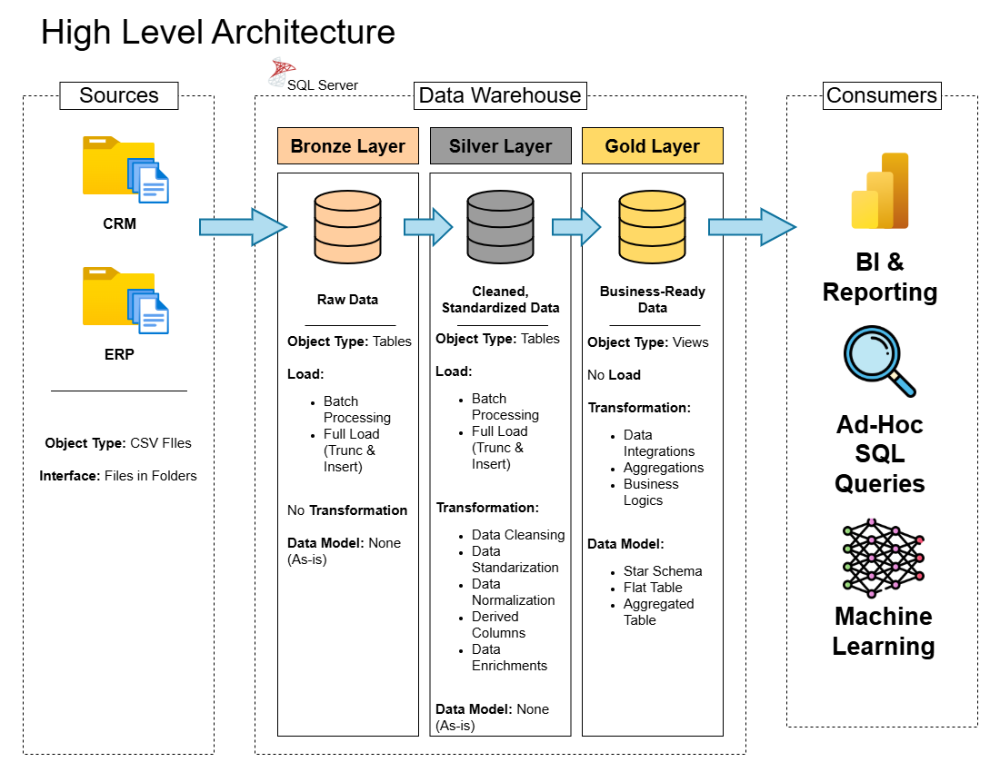

# SQL Data Warehousing & ETL Pipeline

🔗 **Course Context:** This project is part of my complete SQL learning portfolio. View the full course notes and other projects here: [SQL Full Course - From Zero to Hero](https://github.com/Youssef-Hany1/SQL-Course)

---
## 📖 Project Overview
This project simulates an enterprise-grade Data Warehousing environment. It demonstrates the design and execution of an Extract, Transform, Load (ETL) pipeline using Microsoft SQL Server to integrate two distinct source systems (CRM and ERP) via CSV files into a centralized data model. 

---
## 🏗️ Data Architecture
The data architecture for this project follows Medallion Architecture **Bronze**, **Silver**, and **Gold** layers:

- **🥉 Bronze Layer:** Raw data ingestion from CRM and ERP CSV files using `BULK INSERT` operations. No transformations are applied to maintain traceability.
- **🥈 Silver Layer:** Cleansed and standardized data. Transformations include handling nulls, removing unwanted spaces, standardizing domains (e.g., gender, marital status), and adding metadata columns (like load dates).
- **🥇 Gold Layer:** Business-ready data modeled using a **Star Schema** (Dimension and Fact tables). Data is integrated from multiple sources, surrogate keys are generated using `ROW_NUMBER()`, and exposed entirely via `VIEWS` for analytics.

---
## 🚀 Project Requirements

### Building the Data Warehouse (Data Engineering)

#### Objective
Develop a modern data warehouse using SQL Server to consolidate sales data, enabling analytical reporting and informed decision-making.

#### Specifications
- **Data Sources**: Import data from two source systems (ERP and CRM) provided as CSV files.
- **Data Quality**: Cleanse and resolve data quality issues prior to analysis.
- **Integration**: Combine both sources into a single, user-friendly data model designed for analytical queries.
- **Scope**: Focus on the latest dataset only; historization of data is not required.
- **Documentation**: Provide clear documentation of the data model to support both business stakeholders and analytics teams.

---
### BI: Analytics & Reporting (Data Analysis)

#### Objective
Develop SQL-based analytics to deliver detailed insights into:
- **Customer Behavior**
- **Product Performance**
- **Sales Trends**

These insights empower stakeholders with key business metrics, enabling strategic decision-making.  

For more details, refer to [02_docs/02_reference_materials/requirements.md](02_docs/02_reference_materials/requirements.md).

---
## 💻 Tech Stack & Concepts
- **Database Engine:** Microsoft SQL Server
- **IDE:** SQL Server Management Studio (SSMS)
- **Concepts:** DDL/DML, Stored Procedures, Error Handling (`TRY...CATCH`), Execution Duration Logging, Star Schema Data Modeling.

---
## 👨‍🏫 Acknowledgments
Developed as part of the [SQL Full Course for Beginners (30 Hours)](https://www.youtube.com/watch?v=SSKVgrwhzus) by **Data with Baraa**.

## 🤝 Connect

## 🌟 About me
Hi, I'm **Youssef Ayad**. I engineer scalable Medallion pipelines and enterprise data warehouses. Today, I focus on full-stack data engineering: transforming raw infrastructure into clean, actionable insights through optimized SQL—layer by layer.
